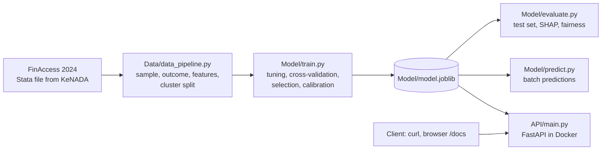

# Predicting Debt Distress Among Kenyan Digital Credit Borrowers

**DSA 8401 Applied Machine Learning: Capstone Project**
Njogu Sharon Wanjiru (103511), Strathmore University

## Overview

Digital loans (Fuliza, M-Shwari, Tala, the Hustler Fund and others) are quick to get, but more Kenyans are struggling to repay them. This project uses the **FinAccess 2024 Household Survey** to predict which digital borrowers are in **debt distress**, to explain what drives the risk, and to serve the model through an API in a Docker container.

**Outcome:** a borrower is in debt distress if, in the past 12 months, they repaid a loan late, missed a payment or did not repay, **and** made a hardship sacrifice to repay (borrowed elsewhere, sold assets, cut food spending, or had assets repossessed).

**Why this data is challenging:** it is raw survey output. It has survey weights, clustered sampling, "don't know/refused" codes, skip patterns, extreme values (some borrowers report hundreds of Fuliza loans), a third of borrowers with missing repayment amounts, and questions that would leak the answer. Each of these is handled in the pipeline.

## Results

| | |
|---|---|
| Digital borrowers analysed | 7,213 |
| Share in debt distress (weighted) | 36.0% |
| Chosen model | LightGBM (calibrated with Platt scaling) |
| Test PR-AUC (chance = 0.38) | 0.64 (95% CI 0.59 to 0.70) |
| Test ROC AUC | 0.77 |
| Recall / precision at the chosen threshold | 0.71 / 0.57 |
| Gain from borrowing behaviour over demographics (H3) | +0.10 PR-AUC (95% CI 0.07 to 0.13) |
| Strongest drivers | Non-digital loans, repayment burden, household shocks, multiple digital loans |

The model is meant for group-level targeting of support and supervision, not for decisions about individual borrowers.

## Project structure

```
API/            FastAPI service (main.py) and an example request
Data/           data pipeline (data_pipeline.py) and instructions for getting the data
Model/          training, evaluation and prediction scripts, the saved model and results
Notebook/       capstone_notebook.ipynb: the full analysis, step by step
Presentation/   slide deck
Dockerfile, docker-compose.yml, requirements.txt, AI_USE.md
```

The written analysis (method, results and reasoning) is in `Notebook/capstone_notebook.ipynb`, and the slides are in `Presentation/Debt_Distress_Capstone_NjoguSharon_103511.pptx`.

## Architecture



## How to run

**1. Data.** The FinAccess 2024 survey file is included as `Data/2024_Finaccess_Publicdata.zip` 

**2. Install** (Python 3.12 or 3.13):

```bash
py -3.13 -m venv .venv               # Windows; on Mac/Linux: python3.13 -m venv .venv
source .venv/Scripts/activate        # Windows Git Bash (PowerShell: .venv\Scripts\Activate.ps1; cmd: .venv\Scripts\activate.bat)
                                     # Mac/Linux: source .venv/bin/activate
pip install -r requirements.txt
```

**3. Run the pipeline** from the project folder:

```bash
python -m Data.data_pipeline         # data -> Data/processed/model_data.parquet
python -m Model.train                # tuning and training -> Model/model.joblib
python -m Model.evaluate             # test results -> Model/results/
python -m Model.predict --input Model/example_input.csv --output predictions.csv
```

The data step takes about a minute. Training and evaluation together take up thirty minutes to an hour on a laptop; training prints a line as each model finishes tuning, so a quiet period is normal.

**4. Or follow the notebook:** `Notebook/capstone_notebook.ipynb` by (`pip install notebook`, then `jupyter notebook`). A full run takes about thirty minutes to an hour.

## Using the API

Follow below steps:

```bash
docker compose up --build            # or, without Docker: uvicorn API.main:app --port 8000
docker compose down                  # to stop and remove the container
```

Open http://localhost:8000 in the browser, or from Git Bash, Mac or Linux:

```bash
curl -X POST localhost:8000/predict -H "Content-Type: application/json" -d @API/example_request.json
```

In Windows PowerShell, use `curl.exe` instead of `curl`.

Example response:

```json
{"distress_probability": 0.41, "high_risk": true,
 "top_drivers": [{"factor": "Multiple borrowing", "effect": "raises risk"},
                 {"factor": "Location", "effect": "lowers risk"},
                 {"factor": "Savings", "effect": "raises risk"}],
 "notice": "Group-level estimate for this type of borrower. Not for decisions about an individual loan applicant."}
```

Other endpoints: `GET /health` and `POST /predict/batch` (`{"borrowers": [ ... ]}`). Invalid input, for example an unknown field or an age under 16, returns an error (HTTP 422).

## Why these techniques

| Choice | Reason |
|---|---|
| PR-AUC as the main metric | The aim is to find distressed borrowers; its chance level equals the prevalence |
| Cluster-grouped cross-validation and bootstrap intervals | The survey samples whole clusters, so neighbours must not appear on both sides of a split |
| Logistic regression benchmark | Complex models often gain little over it on tabular data |
| Platt calibration and an F1-optimal threshold | Probabilities should mean what they say; the threshold balances finding cases against false alarms |
| SHAP grouped by predictor | Explanations that stakeholders can act on |

Techniques I chose not to use:

| Technique | Reason |
|---|---|
| Deep learning | About 6,000 rows of tabular data, where tree models usually do better |
| SMOTE or class weights | Synthetic rows have no survey weight, and reweighting distorts probabilities |
| Time-based split | One survey year only; cluster and county splits are used instead |
| Stacking | The tuned models are within 0.02 PR-AUC of each other |
| PCA | Few, interpretable predictors; components would be hard to explain |

## Limitations

- The survey is cross-sectional, so the results are associations, not causes.
- The repayment and hardship questions cover any loan, not only digital loans.
- Repayment burden is missing for about a third of borrowers (handled with missing-value flags).
- Recall is lower for some smaller groups, such as Nairobi and borrowers aged 55 and over.
- The model was tested within one survey year and should be revalidated on the next FinAccess round.
